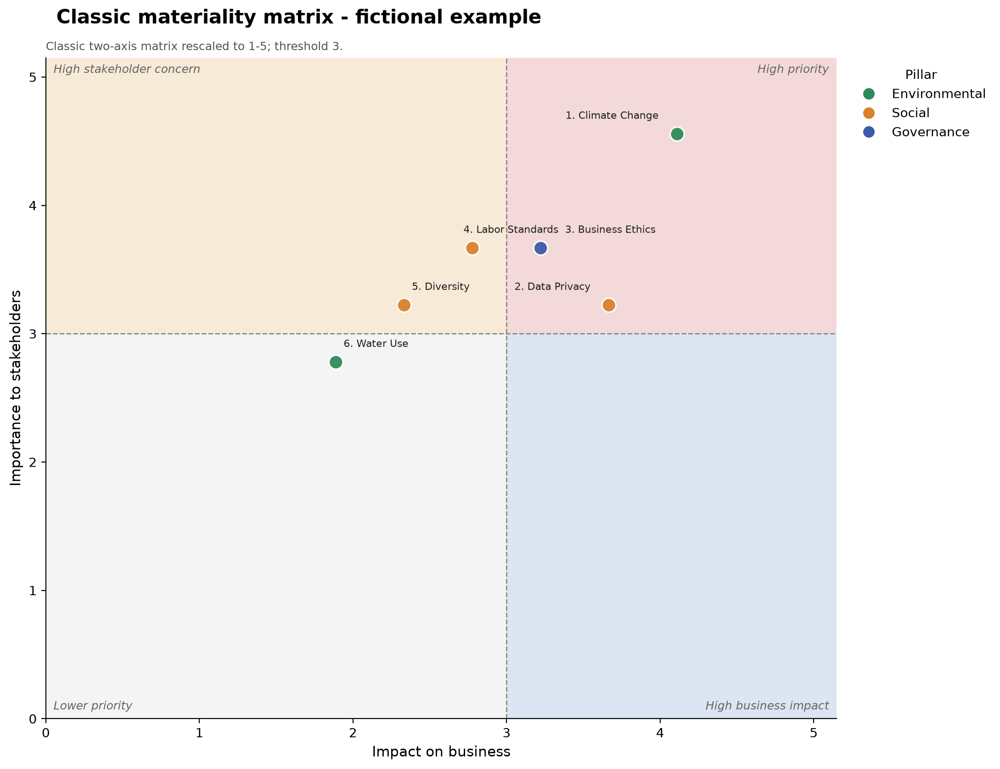

# materiality-matrix

**Double materiality assessments and materiality matrices in Python, from an Excel sheet or CSV files.**

`materiality-matrix` turns a topic list and a stakeholder survey into a scored,
ranked **double materiality** assessment (impact materiality + financial
materiality, following the criteria in ESRS 1 under the EU CSRD) and draws a
publication-quality matrix plus an interactive HTML version. No spreadsheet
formulas to maintain, no proprietary tool, and every number traceable to an
input row.


*Matrix above: the bundled **fictional** example ("Example Manufacturing Co."
does not exist; all scores and survey answers are invented).*

## Why

Materiality matrices are usually built by hand in spreadsheets and slide
decks: the scoring rules are hidden in cell formulas, stakeholder groups are
weighted by head-count by accident, and the chart is redrawn every year.
This package makes the method explicit, testable and repeatable:

- **Double materiality, ESRS-style**: severity from scale, scope and
  irremediable character; likelihood for potential impacts; severity takes
  precedence for potential human-rights impacts; financial materiality from
  magnitude x likelihood ([method](docs/METHOD.md)).
- **Stakeholder surveys done properly**: ratings are summarised per
  stakeholder group, then combined with explicit group weights, so ten
  employees don't outvote one investor group by head-count unless you want them to.
- **Validation that tells you everything at once**: every bad cell, missing
  column and unknown topic in one error message.
- **Plots ready for a report**: quadrants, thresholds, E/S/G colours, ranked
  labels that avoid overlap, bubble size by survey responses; plus a Plotly
  HTML matrix with hover details.
- **Classic matrices too**: point it at an old "stakeholder importance vs
  business impact (1-10)" sheet and get the same quality of chart.

## Install

```bash
pip install "materiality-matrix[interactive] @ git+https://github.com/DataWithSyed/materiality-matrix.git"
```

or, from a clone:

```bash
git clone https://github.com/DataWithSyed/materiality-matrix.git
cd materiality-matrix
pip install -e ".[dev]"
pytest
```

Python 3.10+. Core dependencies: pandas, numpy, matplotlib, openpyxl. Plotly is optional (`[interactive]`).

## Quickstart

```bash
materiality example my_assessment.xlsx          # copy the fictional example workbook
materiality validate my_assessment.xlsx         # check it against the schema
materiality build my_assessment.xlsx \
    --out matrix.png --html matrix.html \
    --csv scores.csv --markdown summary.md
```

Start your own from an empty workbook with `materiality template my_template.xlsx`.

Useful options for `build`:

| Option | Meaning | Default |
|---|---|---|
| `--impact-threshold`, `--financial-threshold` | material at or above this score (1-5) | 3.0 |
| `--survey-blend 0.4` | share of the survey in both scores | 0.3 |
| `--weight "NGOs=2"` | override a stakeholder group weight (repeatable) | from `weights` sheet, else 1 |
| `--aggregation median` | summarise ratings within a group by median | mean |
| `--rating-scale 10` | survey ratings are on 1-10 (rescaled to 1-5) | 5 |

A classic two-axis sheet:

```bash
materiality classic old_matrix.xlsx --out classic.png
```



### Python API

```python
import materiality as mm
from materiality.plot import plot_matrix, plot_interactive

data = mm.load("my_assessment.xlsx")            # or a folder with topics.csv / survey.csv / weights.csv
cfg = mm.ScoringConfig(impact_threshold=3.0, financial_threshold=3.0,
                       survey_blend_impact=0.3, group_weights={"NGOs": 1.5})
scored = mm.score(data, cfg)
print(scored[["rank", "topic", "esrs", "impact_score", "financial_score", "quadrant"]])
plot_matrix(scored, "matrix.png", title="Double materiality matrix 2026")
plot_interactive(scored, "matrix.html")
```

## Input format (short version)

A workbook with sheet `topics` and optional sheets `survey` and `weights`
(or the same as CSV files in a folder). Full schema: [docs/SCHEMA.md](docs/SCHEMA.md).

| topics column | meaning |
|---|---|
| `topic_id`, `topic`, `esrs` | id, name, ESRS topical standard `E1`-`E5`, `S1`-`S4`, `G1` or `ENTITY` |
| `impact_type` | `actual_negative`, `potential_negative`, `actual_positive`, `potential_positive` |
| `scale`, `scope`, `irremediability` | severity criteria, 1-5 (irremediability for negative impacts only) |
| `impact_likelihood` | 0-1, for potential impacts |
| `human_rights` | flag potential negative human-rights impacts |
| `fin_magnitude`, `fin_likelihood` | financial effect magnitude (1-5) and likelihood (0-1) |

`survey`: `respondent_id, stakeholder_group, topic_id, impact_rating, financial_rating`.
`weights`: `stakeholder_group, weight`.

## Example results (fictional data)

With default settings the example's 19 topics split into 1 double-material,
4 impact-only, 1 financial-only and 13 not-material topics
([full table](assets/example_summary.md), [scores CSV](assets/example_scores.csv)).
These numbers describe invented data and only show what the output looks like.

## Method and sources

The scoring rules and their sources are explained in [docs/METHOD.md](docs/METHOD.md). In short:

- **Impact materiality**: ESRS 1 section 3.4, paras 43-46 and AR 10-11 (severity = scale, scope, irremediable character; likelihood for potential impacts; severity precedence for potential human-rights impacts).
- **Financial materiality**: ESRS 1 section 3.5, paras 47-51 (likelihood of occurrence x potential magnitude of financial effects).
- **Topic list**: ESRS 1 Appendix A, AR 16.
- **Stakeholder engagement and material topics**: GRI 3: Material Topics 2021.

ESRS do **not** prescribe numeric scales, formulas or thresholds; the ones
here are transparent defaults you should set for your own assessment.

Sources:

1. Commission Delegated Regulation (EU) 2023/2772 of 31 July 2023 supplementing Directive 2013/34/EU as regards sustainability reporting standards (ESRS Set 1), Annex I, ESRS 1 *General requirements*. <https://eur-lex.europa.eu/eli/reg_del/2023/2772/oj>
2. Directive (EU) 2022/2464 (Corporate Sustainability Reporting Directive). <https://eur-lex.europa.eu/eli/dir/2022/2464/oj>
3. EFRAG, *IG 1: Materiality Assessment Implementation Guidance* (2024).
4. Global Reporting Initiative, *GRI 3: Material Topics 2021*. <https://www.globalreporting.org/>
5. EFRAG Knowledge Hub, simplified ESRS 1 *General Requirements* (version labelled 2026-09-21 Official Journal), which refers to the Omnibus I Directive (EU) 2026/470. <https://knowledgehub.efrag.org/eng/interactive/simplified-esrs/esrs-1/2026-09-21-official-journal>

> **Regulatory note.** v0.1 follows the ESRS Set 1 text. The simplified ESRS 1
> keeps the same severity and likelihood criteria (paras 40, 41 and 50 there)
> but shortens the topic list (for example, it folds several G1 sub-topics
> into "corporate culture"). Support for the simplified taxonomy is on the
> roadmap. This tool supports an assessment; it is not legal or assurance advice.

## Roadmap

A long list of planned additions lives in [ROADMAP.md](ROADMAP.md): a
Streamlit app, an IRO (impacts, risks and opportunities) register,
Monte-Carlo sensitivity of scores, survey import from common form tools,
PDF/Word report export, rule-based text mapping to ESRS topics, and more.
New features land regularly; see [CHANGELOG.md](CHANGELOG.md).

## Contributing

Issues and pull requests are welcome: see [CONTRIBUTING.md](CONTRIBUTING.md).
A CI workflow example is in [docs/ci-example.yml](docs/ci-example.yml).

## License

MIT, see [LICENSE](LICENSE).
