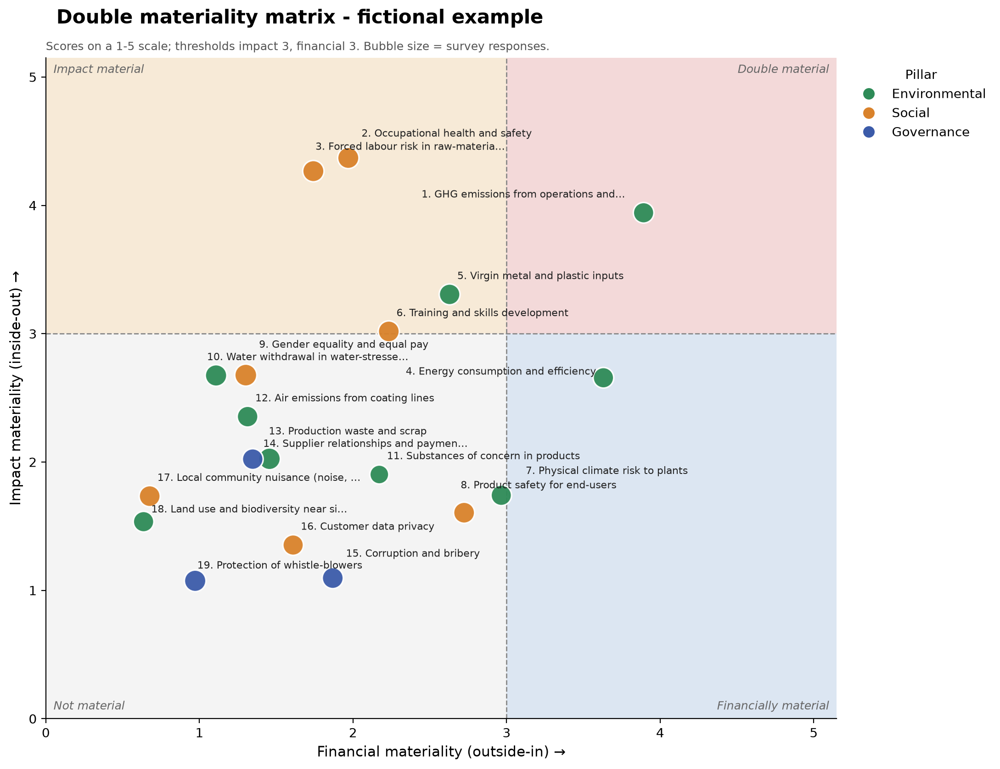
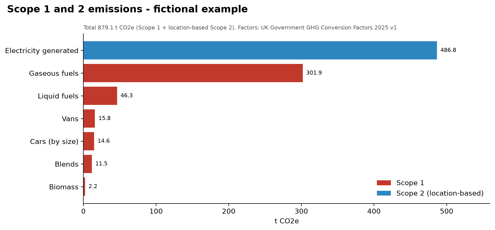

# sustainability-toolkit (`sustainkit`)

**An open-source Python toolkit for sustainability management: double
materiality, GHG accounting, stakeholder mapping and, step by step, the rest of a company's
sustainability workflow, from data in Excel or CSV to charts and report tables.**

Most sustainability work still lives in disconnected spreadsheets: a
materiality sheet here, an emissions calculator there, a KPI log, a
checklist, a regulatory watchlist. `sustainkit` puts these into one tested
Python package with one CLI. Every rule is written down, every number can be
traced to an input row and a cited source, and the same inputs give the same
outputs every year.

| Double materiality matrix | Scope 1 and 2 inventory |
|---|---|
|  |  |

*Both charts use the bundled **fictional** example company ("Example
Manufacturing Co." does not exist). Only the GHG emission factors are real.*

## Modules

| Module | Status | What it does |
|---|---|---|
| [`materiality`](docs/MATERIALITY.md) | **available** (v0.1) | Double materiality (ESRS 1 impact + financial), stakeholder survey weighting, thresholds, matrix PNG + interactive HTML, classic two-axis sheets |
| [`ghg`](docs/GHG.md) | **available** (v0.2) | Scope 1 and 2 inventory with the UK Government 2025 conversion factors (970 factors bundled), CO2/CH4/N2O split, location- and market-based Scope 2, biogenic CO2 kept outside the scopes |
| [`stakeholders`](docs/STAKEHOLDERS.md) | **available** (v0.3) | Stakeholder register with validation, influence x interest map and strategies, ESRS 1 affected/user categories, engagement plan (overdue / due soon), group weights for the materiality survey |
| `kpis` | planned | KPI library, multi-year E/S/G data logs, year-on-year change, targets |
| `energy` | planned | Energy audit: baseline, saving measures, payback/NPV, abatement cost curve |
| `water` | planned | Water balance, intensity metrics, practice scoring |
| `circularity` | planned | Circular-economy self-assessment across the product life cycle |
| `impact` | planned | Environmental impact screening (inputs/outputs inventory, severity) |
| `supplychain` | planned | Supplier risk screening and ethical sourcing workflow |
| `social` | planned | Social responsibility and human-rights due-diligence checklists |
| `governance` | planned | ESG governance maturity scoring |
| `checklists` | planned | Generic checklist engine: status, evidence, completeness, gaps |
| `actions` | planned | Action plans and initiative tracker |
| `risk` | planned | Sustainability risk register and trend (PESTLE-style) analysis |
| `regwatch` | planned | Regulatory watchlist with deadlines |
| `disclosure` | planned | ESRS / GRI disclosure index and reporting completeness |
| `reporting` | planned | Word / PDF / Excel / slide export |
| `app` | planned | Streamlit app over all modules |

`sustainkit modules` prints this list from the installed version. The
planned order is in [ROADMAP.md](ROADMAP.md); see
[docs/MODULE_MAP.md](docs/MODULE_MAP.md) for how the modules cover a typical
sustainability-management workbook.

## Install

```bash
pip install "sustainkit[interactive] @ git+https://github.com/DataWithSyed/sustainability-toolkit.git"
```

From a clone:

```bash
git clone https://github.com/DataWithSyed/sustainability-toolkit.git
cd sustainability-toolkit
pip install -e ".[dev]"
pytest
```

Python 3.10+. Core dependencies: pandas, numpy, matplotlib, openpyxl. Plotly is optional (`[interactive]`).

## Quickstart

### GHG inventory (Scope 1 and 2)

```bash
sustainkit ghg example activities.csv          # fictional example activity data
sustainkit ghg factors natural gas             # search the factor table
sustainkit ghg calc activities.csv --markdown ghg.md --csv ghg_rows.csv --chart ghg.png
```

An activity file is one row per activity: `activity, quantity, unit`, plus
optional `site, period, level1, level2, level4, variant, market_factor, note`.

```csv
site,activity,quantity,unit,level2,variant,market_factor
Plant North,Natural gas,1200000,kWh (Gross CV),,,
Plant North,Electricity: UK,2100,MWh,,,0
Fleet,Medium car,85000,km,Cars (by size),Diesel,
```

Fictional example result (factor values are the published 2025 ones):

| Item | t CO2e |
|---|---|
| Scope 1 | 392.36 |
| Scope 2 (location-based) | 486.75 |
| Scope 2 (market-based) | incomplete: one site has no contractual factor |
| Scope 1 + 2 (location-based) | 879.11 |
| Biogenic CO2 (outside of scopes) | 69.61 |

```python
import pandas as pd
from sustainkit.ghg import calculate, load_factors
from sustainkit.ghg.plot import plot_breakdown

inv = calculate(pd.read_csv("activities.csv"), load_factors())
print(inv.summary())          # Scope 1, Scope 2 location/market, biogenic
print(inv.by("site"))         # t CO2e by site and scope
print(inv.gases())            # CO2 / CH4 / N2O split
plot_breakdown(inv, "ghg.png", by="level2")
```

### Stakeholder map and survey weights

```bash
sustainkit stakeholders example stakeholders.csv     # fictional example register
sustainkit stakeholders map stakeholders.csv --as-of 2026-11-26 --chart map.png --markdown map.md --weights weights.csv
```

A register is one row per stakeholder: `stakeholder, group, influence, interest`, plus optional
`category` (affected / user / both, ESRS 1 para 22), `owner, channel, last_engaged, frequency_days, notes`.
The command classifies each stakeholder (Manage closely / Keep satisfied / Keep informed / Monitor),
flags overdue engagement and writes `weights.csv` for the materiality survey.
Fictional example: 7 / 2 / 5 / 1 stakeholders per quadrant, 10 of 15 overdue as of 2026-11-26.


### Double materiality

```bash
sustainkit materiality example assessment.xlsx
sustainkit materiality build assessment.xlsx --out matrix.png --html matrix.html --csv scores.csv
```

```python
from sustainkit import materiality as mm
from sustainkit.materiality.plot import plot_matrix

scored = mm.score(mm.load("assessment.xlsx"), mm.ScoringConfig(impact_threshold=3.0))
plot_matrix(scored, "matrix.png")
```

Upgrading from `materiality-matrix` 0.1? `import materiality` and the
`materiality` command still work and point to `sustainkit.materiality`.

## Principles

- **Sourced or labelled.** Factors and rules cite real documents with year
  and version. Where a standard leaves a choice open (scales, thresholds),
  the docs say it is a choice of this tool.
- **Honest gaps.** If something can't be computed from the inputs (e.g. a
  market-based Scope 2 total without contractual factors), it is reported as
  incomplete, not filled with a guess.
- **Fictional examples only.** Example companies and numbers are invented
  and labelled as such.
- **Not advice.** The toolkit supports assessments and inventories; it is not
  legal, assurance or verification advice.

## Sources

- UK Government GHG Conversion Factors for Company Reporting 2025, flat file v1 (DESNZ), Open Government Licence v3.0. <https://www.gov.uk/government/publications/greenhouse-gas-reporting-conversion-factors-2025>
- WRI/WBCSD, *The Greenhouse Gas Protocol: A Corporate Accounting and Reporting Standard*, revised edition (2004).
- WRI, *GHG Protocol Scope 2 Guidance* (2015).
- Commission Delegated Regulation (EU) 2023/2772 (ESRS Set 1), ESRS 1. <https://eur-lex.europa.eu/eli/reg_del/2023/2772/oj>
- Directive (EU) 2022/2464 (CSRD). <https://eur-lex.europa.eu/eli/dir/2022/2464/oj>
- EFRAG, *IG 1: Materiality Assessment Implementation Guidance* (2024).
- GRI 3: Material Topics 2021.
- EFRAG Knowledge Hub, simplified ESRS 1 (version labelled 2026-09-21 Official Journal; Omnibus I Directive (EU) 2026/470). <https://knowledgehub.efrag.org/eng/interactive/simplified-esrs/esrs-1/2026-09-21-official-journal>

- Mendelow, A. L. (1981). Environmental Scanning: The Impact of the Stakeholder Concept. *Proceedings of the Second International Conference on Information Systems (ICIS 1981)*. <https://aisel.aisnet.org/icis1981/20/> (origin of the power grid; the influence x interest variant is a later textbook adaptation).

Module-level method notes: [docs/MATERIALITY.md](docs/MATERIALITY.md), [docs/GHG.md](docs/GHG.md), [docs/STAKEHOLDERS.md](docs/STAKEHOLDERS.md).

## Contributing

Issues and pull requests are welcome: see [CONTRIBUTING.md](CONTRIBUTING.md).
A CI workflow example is in [docs/ci-example.yml](docs/ci-example.yml).
New features land regularly; see [CHANGELOG.md](CHANGELOG.md).

## License

MIT, see [LICENSE](LICENSE). The bundled UK emission factors are
Crown copyright, reused under the Open Government Licence v3.0.
