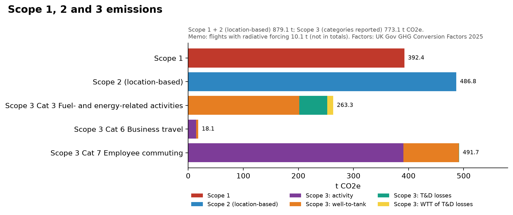

# `sustainkit.ghg.scope3`: Scope 3 categories 3, 6 and 7

Added in 0.5.0. Three Scope 3 categories that almost every company can
report from data it already has:

| GHG Protocol category | Input | What is added |
|---|---|---|
| **3** Fuel- and energy-related activities (not in Scope 1 or 2) | the Scope 1-2 activity file | (a) well-to-tank (WTT) of Scope 1 fuels and owned-vehicle fuel, (b) WTT of purchased electricity / heat generation, (c) transmission and distribution (T&D) losses and their WTT |
| **6** Business travel | trip rows | flights, rail, bus, taxi, grey-fleet cars, ferries, hotel nights (+ WTT of each mode; T&D for electric cars) |
| **7** Employee commuting | trip rows or a commuting survey | same modes, plus optional homeworking (teleworking) |

Category 3 subcategory (d), electricity sold to end users, applies to utilities only and is not covered.

## Method

Distance-based / average-data methods of the GHG Protocol *Corporate Value
Chain (Scope 3) Accounting and Reporting Standard* (2011) and the
*Technical Guidance for Calculating Scope 3 Emissions* v1.0 (2013):
emissions = activity x emission factor. Each result row keeps the factor
ID, the factor value and the component (`activity`, `WTT`, `T&D losses`,
`WTT of T&D losses`), so every tonne can be traced.

- **WTT** is the upstream emission of extracting, refining and transporting a
  fuel (or generating electricity) before it is used. The UK factor set
  publishes it per mode/fuel, so it is matched on the same activity, size,
  fuel and unit. For business travel the UK set lists WTT in separate
  tables; `travel()` adds it by default (`include_wtt=False` to leave it out).
- **Hotel nights** (optional in category 6 under the Scope 3 Standard) use
  the UK per-country "room per night" factors. Countries with a blank 2025
  factor are not bundled; such rows fail with a clear error rather than
  falling back to another country.
- **Homeworking** (optional in category 7) uses the UK "Homeworking"
  factor per full-time-equivalent working hour (office equipment + heating,
  or either part).
- **Category 3** reuses the quantities of the Scope 1-2 inventory in the
  Scope 1-2 factor's unit. Refrigerants and process gases have no upstream
  factor by nature and are skipped. Any other Scope 1-2 row without a
  published WTT/T&D factor makes category 3 **incomplete** (listed in the
  report) rather than estimated.
- **Electricity in category 3** uses the UK location-based WTT and T&D
  factors for every Scope 2 electricity row, also rows with a contractual
  (market-based) factor. This is a tool choice: no supplier-specific
  upstream factors are bundled.

### Flights

- The UK flight factors **already include the 8 % uplift** on great-circle
  distance for indirect routing and delays (2025 methodology paper, paras
  8.38-8.39). Enter the great-circle distance; `haversine_km()` computes it
  from coordinates. Do not add the uplift again.
- Haul: domestic = within the UK; the paper's preferred definition puts
  flights between the UK and Europe / North Africa in short-haul and the rest
  in long-haul (paras 8.9-8.10). `International, to/from non-UK` covers
  flights that neither start nor end in the UK. The user chooses the haul.
- **Radiative forcing (RF).** The inventory figure uses the "Without RF"
  factors (direct CO2, CH4, N2O). The "With RF" figure, which applies the
  1.7 multiplier to the CO2 part (paras 8.40-8.44, with the paper's caveat
  that the multiplier is uncertain), is reported as a **memo item, not in the
  totals**. This split is a tool choice; set `variant=With RF` on a row to
  put the RF figure in the inventory instead.

### Units and travellers

- Flights, rail, bus, ferries: `passenger.km` (aliases `pkm`, or `km` =
  distance per traveller). `miles` are converted (1 mile = 1.609344 km).
- Cars, taxis per vehicle: `km` or `miles`. The optional `travellers`
  column multiplies per-passenger units only, so a car shared by three
  people is counted once.
- Hotels: `nights` / `room nights`. Homeworking: `FTE hours`.

### Commuting survey

`commuting_trips(survey, days_per_year, homeworking_fte_hours)` turns one
row per mode (and site) into trip rows:

    distance = employees x one_way_km x 2 x office_days  (/ occupancy for car modes)

`days_per_year` has **no default**: office days depend on the company's
working pattern (holidays, hybrid work), so give a column or the argument.

## Use

```bash
sustainkit ghg scope3-example ex           # fictional trips, survey, activities
sustainkit ghg scope3 --trips ex/trips.csv --commuting ex/commuting_survey.csv \
    --homeworking-hours 41250 --inventory ex/activities.csv \
    --markdown scope3.md --csv scope3_rows.csv --chart scope3.png
```

```python
from sustainkit.ghg import calculate, scope3_inventory
inv = calculate(activities)                    # Scope 1-2
s3 = scope3_inventory(trips, inv, survey, homeworking_fte_hours=41250)
s3.summary(); s3.by_category(); s3.rf_memo_t
```

Trip file columns: `category` (6 / `business travel`, 7 / `commuting`),
`activity` (factor name, e.g. `Long-haul, to/from UK`, `National rail`,
`Medium car`, `Germany`), `quantity`, `unit`; optional `level2`, `level4`,
`variant` to disambiguate (e.g. `Cars (by size)` + `Diesel`, `Economy
class`), `travellers`, `site`, `period`, `id`, `note`. Every problem in a
file is listed in one error. Find names with
`load_scope3_factors().search("rail")`.

## Fictional example (Example Manufacturing Co., 2025)

The company and every quantity are invented; only the factors are real.

| Category | t CO2e |
|---|---|
| Cat 3 (a) WTT of Scope 1 fuels | 75.21 |
| Cat 3 (b) WTT of purchased electricity | 126.22 |
| Cat 3 (c) T&D losses incl. WTT | 61.88 |
| **Cat 3 total** | **263.31** |
| Cat 6 business travel (air 6.68, cars 5.86, hotels 2.96, rail 1.71, taxi 0.55, ferry 0.33) | 18.09 |
| Cat 7 commuting (cars 427.45, rail 27.99, bus 22.52, homeworking 13.77) | 491.74 |
| **Scope 3, categories reported** | **773.14** |
| Memo: flights with radiative forcing (not in totals) | 10.10 (vs 6.68 without) |

For comparison, Scope 1 + location-based Scope 2 of the same example is
879.11 t, so these three categories alone add 88 % on top. WTT is 20 % of
the category 6 and 7 total (104.1 of 509.8 t).



## Bundled factors

`uk_gov_ghg_2025_scope3.csv`: 967 Scope 3 factors from the UK Government
GHG Conversion Factors for Company Reporting 2025, flat file v1 (DESNZ, Open
Government Licence v3.0): business travel air/land/sea, hotel stay,
homeworking, T&D (UK electricity, district heat, EVs) and WTT (fuels,
bioenergy, electricity, heat and steam, flights, ferries, passenger vehicles,
delivery vehicles). Values are copied unchanged; blank published factors are
left out. Rebuild both tables with `python examples/build_uk_ghg_factors.py`.

## Limits

- UK factors. They suit UK operations and are a common international proxy,
  but country-specific factors are better where available (roadmap).
- Average-data method only: no fuel-based or supplier-specific travel
  emissions yet, no spend-based method (roadmap item: categories 1-15
  scaffolding).
- Not assurance or verification advice.

## Sources

1. DESNZ, *UK Government GHG Conversion Factors for Company Reporting 2025*, flat file v1, and the 2025 methodology paper (paras 8.9-8.10, 8.38-8.44 cited above). Open Government Licence v3.0. <https://www.gov.uk/government/publications/greenhouse-gas-reporting-conversion-factors-2025>
2. WRI/WBCSD, *Corporate Value Chain (Scope 3) Accounting and Reporting Standard* (2011).
3. WRI/WBCSD, *Technical Guidance for Calculating Scope 3 Emissions*, version 1.0 (2013).
