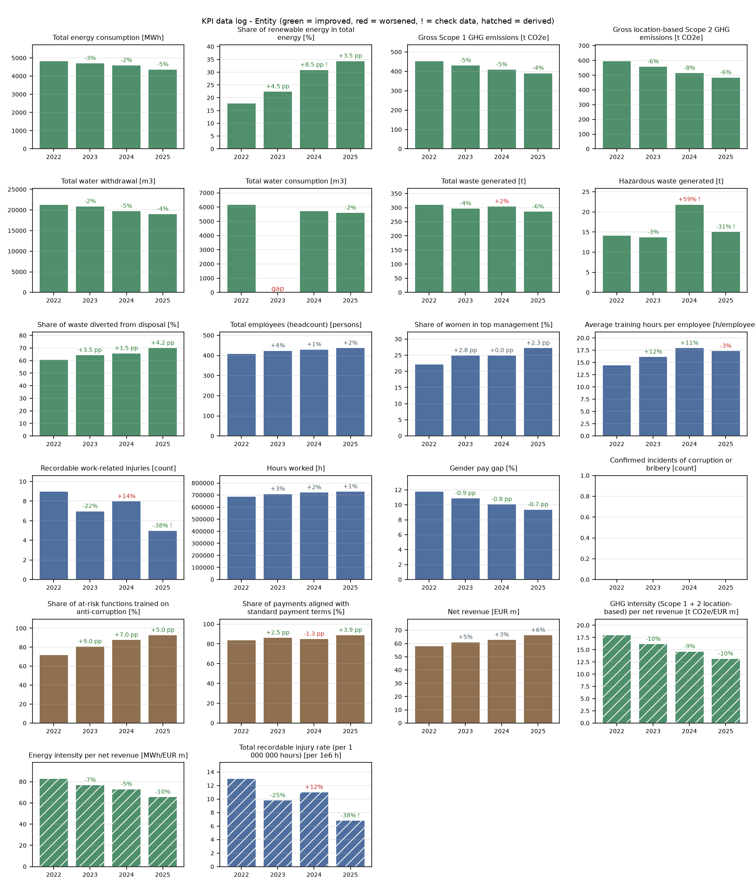

# `sustainkit.kpis` - KPI library and multi-year data log

Added in 0.4.0. Turns a year-by-year E/S/G data log (CSV or Excel) into a validated table of values,
year-on-year changes, derived intensity KPIs, flags for data checks, and small-multiple charts.

```bash
sustainkit kpis library water                    # search the bundled KPI library
sustainkit kpis example kpi_log.csv              # fictional example data log
sustainkit kpis report kpi_log.csv --markdown kpis.md --csv kpis.csv --changes changes.csv --chart kpis.png
```

```python
from sustainkit.kpis import build_report, load_library, load_log
from sustainkit.kpis.plot import plot_kpis

rep = build_report(load_log("kpi_log.csv"), load_library())
print(rep.summary[["kpi_id", "latest", "change_text", "status", "flags"]])
print(rep.wide())             # KPI x year table (entered + derived)
plot_kpis(rep, "kpis.png")
```

## KPI library

24 indicators in `src/sustainkit/kpis/data/library.csv` (E 13, S 7, G 4 including the revenue
denominator), each with unit, pillar, direction, kind, allowed range and a reference to an ESRS
disclosure requirement and/or a GRI disclosure. Three are **derived** (`kind = ratio`): GHG intensity
(Scope 1 + location-based Scope 2 per EUR m revenue), energy intensity per EUR m revenue, and the total
recordable injury rate per 1 000 000 hours worked.

| Column | Meaning |
|---|---|
| `direction` | `lower_better`, `higher_better` or `neutral` (no preferred direction in the standard, e.g. headcount; a company can set its own target) |
| `kind` | `sum` (additive), `last` (stock at year end), `mean` (per-unit average), `share` (percentage), `ratio` (derived) |
| `min`, `max` | allowed range, used by validation (shares 0-100; pay gap -100 to 100) |
| `numerator`, `denominator`, `scale` | derived KPIs only: (sum of numerator KPIs) x scale / denominator |
| `esrs`, `gri` | references at disclosure-requirement level (see below) |

References:

* **ESRS**: disclosure requirements of ESRS Set 1, Commission Delegated Regulation (EU) 2023/2772
  (E1-5 energy consumption and mix; E1-6 gross Scopes 1, 2, 3 and total GHG emissions; E3-4 water
  consumption; E5-5 resource outflows; S1-6 characteristics of employees; S1-9 diversity metrics; S1-13
  training and skills development metrics; S1-14 health and safety metrics; S1-16 remuneration metrics;
  G1-3 prevention and detection of corruption and bribery; G1-4 incidents of corruption or bribery; G1-6
  payment practices). **Gap:** the mapping to the simplified ESRS adopted after the 2026 Omnibus
  amendments is not done yet; codes may change there.
* **GRI**: GRI 2 General Disclosures 2021 (2-7), GRI 205 Anti-corruption 2016 (205-2, 205-3), GRI 302
  Energy 2016 (302-1, 302-3), GRI 303 Water and Effluents 2018 (303-3, 303-5), GRI 305 Emissions 2016
  (305-1 to 305-4), GRI 306 Waste 2020 (306-3, 306-4), GRI 403 Occupational Health and Safety 2018 (403-9),
  GRI 404 Training and Education 2016 (404-1), GRI 405 Diversity and Equal Opportunity 2016 (405-1, 405-2).
* Definitions in the library are short paraphrases written for this toolkit, not quotations. Two
  definitional differences are noted in the library itself: the gender pay gap follows the ESRS
  definition (difference as a percentage of men's average pay; GRI 405-2 reports a ratio instead), and
  the injury rate uses 1 000 000 hours (ESRS S1; GRI 403-9 allows 200 000 or 1 000 000).

Own indicators: `--library-extra extra.csv` (same columns) appends rows or overrides bundled ones;
`--library custom.csv` replaces the library.

## Data log

Long format (one row per KPI and year, optional `site`, `unit`, `source`, `note`):

```csv
kpi_id,year,value,unit,source
ghg_scope1_t,2024,410.6,t CO2e,Fuel invoices + sustainkit ghg
ghg_scope1_t,2025,392.36,t CO2e,Fuel invoices + sustainkit ghg
```

Wide format also works: `kpi_id` (+ `site`, `unit`) and one column per year (`2022, 2023, ...`).

### Validation (every problem listed at once)

Unknown `kpi_id`, derived KPIs entered by hand, years that are not calendar years, non-numeric values,
duplicate KPI/year(/site) rows, values outside the library range, and a `unit` that differs from the
library unit. Units are **not converted silently**: convert before loading.

### Rules (tool choices, not requirements of any standard)

* Year-on-year change only between consecutive years. A missing year is a **gap**; no change is
  computed across it and the KPI is listed under "Incomplete".
* Percentage KPIs report the change in **percentage points** first, then the relative change.
* `|relative change| > 25 %` (`--swing`) marks "check data": a prompt to check the source, not an error.
  The same relative rule applies to percentages and small counts, so a few injuries more or less can be
  flagged; that is intended.
* Status: `improved` / `worsened` from the library direction; `up` / `down` for neutral KPIs; `no change`.
* CAGR from the first to the latest year for positive amounts (not for percentages).
* Derived KPIs only when every input exists for that year (and site); otherwise reported incomplete with
  the missing input named.
* With a `site` column, additive KPIs (`sum`, `last`) are also totalled as "All sites". Averages and
  percentages are **not** totalled, because that needs weights the log does not contain.

## Fictional example

`sustainkit kpis example` writes a 2022-2025 log for the fictional "Example Manufacturing Co." (values
invented; the 2025 Scope 1 and location-based Scope 2 totals match the `sustainkit ghg` example, 392.36 t
and 486.75 t). Results ([full summary](../assets/kpis_example_summary.md)):

| KPI | 2025 | vs 2024 | Status | Flags |
|---|---|---|---|---|
| Total energy consumption | 4,380 MWh | -5.0 % | improved | |
| Renewable share | 34.5 % | +3.5 pp | improved | check data 2024 (+8.5 pp, +38 %) |
| GHG intensity (S1 + S2 LB) per EUR m | 13.22 t/EUR m | -10.1 % | improved | derived |
| Water consumption | 5,610 m3 | -2.4 % | improved | gap 2023 (incomplete) |
| Hazardous waste | 15.1 t | -31.1 % | improved | check data 2024 (+59 %) and 2025 |
| Average training hours | 17.4 h | -3.3 % | worsened | |
| TRIR per 1 000 000 h | 6.84 | -38.1 % | improved | derived; check data 2025 |



## Limitations

* No targets or trajectories yet (roadmap 20) and no KPI selection scoring (roadmap 21).
* No unit conversion; no restatement handling (a restated prior year simply replaces the old value).
* References are at disclosure-requirement level, not individual datapoints; simplified-ESRS mapping open.
