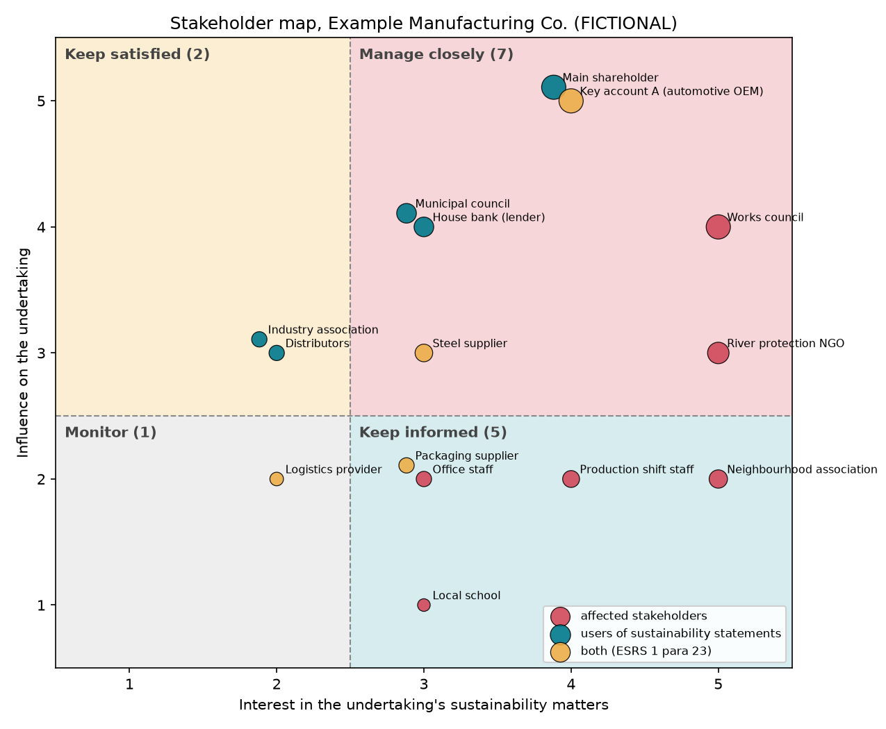

# `sustainkit.stakeholders`: register, influence x interest map, engagement plan, survey weights

Added in v0.3.0.

## What it does

1. **Loads and validates a stakeholder register** (CSV or Excel) and lists every problem at once:
   missing columns, blank names, duplicate stakeholders, ratings outside the scale, unknown
   categories, bad dates.
2. **Classifies each stakeholder on an influence x interest grid** into four strategies:
   *Manage closely*, *Keep satisfied*, *Keep informed*, *Monitor*.
3. **Builds an engagement plan**: next due date from the last engagement and a review interval,
   with status *overdue*, *due soon* (within 14 days), *ok* or *never engaged*.
4. **Derives stakeholder-group weights for the materiality survey** (`stakeholder_group, weight`),
   in the format `sustainkit materiality` reads. It also checks that the register groups and the
   survey groups match.
5. **Plots the map** (PNG) with quadrant shading, ESRS stakeholder categories as colours and
   point size by salience (influence x interest).



## Register format

| Column | Required | Meaning |
|---|---|---|
| `stakeholder` | yes | Name of the stakeholder (unique) |
| `group` | yes | Stakeholder group. Use the same names as in the materiality survey (`stakeholder_group`) |
| `influence` | yes | Influence on the undertaking, 1..scale (default 1-5) |
| `interest` | yes | Interest in the undertaking's sustainability matters, 1..scale |
| `category` | no | `affected`, `user` or `both` (ESRS 1 paras 22-23, see below) |
| `owner`, `channel`, `notes` | no | Free text carried through to the outputs |
| `last_engaged` | no | Date of the last engagement (YYYY-MM-DD) |
| `frequency_days` | no | Review interval for this stakeholder; overrides the strategy default |

## Method and sources

**Stakeholder categories.** ESRS 1 (Commission Delegated Regulation (EU) 2023/2772), para 22:
"Stakeholders are those who can affect or be affected by the undertaking", in two main groups:
(a) *affected stakeholders*, whose interests are or could be affected by the undertaking's
activities and business relationships across its value chain, and (b) *users of sustainability
statements* (investors, lenders and other creditors, business partners, trade unions, civil
society, governments, analysts and academics). Para 23: some stakeholders belong to both groups.
Para 24 makes engagement with affected stakeholders central to due diligence and the materiality
assessment. The `category` column records exactly this distinction. The tool does not decide it
for you.

**Influence x interest grid.** This is the power-interest grid of strategy textbooks. It is usually
credited to Mendelow (1981, *Environmental Scanning: The Impact of the Stakeholder Concept*,
Proceedings of the Second International Conference on Information Systems). Mendelow's own matrix
set stakeholder power against the **dynamism** of the stakeholder's environment. The *interest*
axis is a later textbook adaptation (often cited, wrongly, as "Mendelow 1991"). No reporting
standard prescribes this grid. The following are **tool choices** you can change:

| Choice | Default | Option |
|---|---|---|
| High / low cut-off | rating >= scale midpoint (3 on 1-5) is "high" | `--threshold`, `MapConfig(threshold=...)` |
| Strategy names | Manage closely / Keep satisfied / Keep informed / Monitor | `QUADRANTS` |
| Review interval | 30 / 90 / 90 / 180 days | `MapConfig(frequency_days=...)`, per row `frequency_days` |
| "Due soon" window | 14 days | `DUE_SOON_DAYS` |
| Group weight scheme | `salience` = mean of influence x interest in the group | `influence`, `interest`, `mean`, `equal` |

**Group weights.** A group's weight is the *mean* stakeholder score in that group under the chosen
scheme. The weights are then scaled so their mean over groups is 1. Using the mean rather than the
sum means a group does not gain weight just because more of its members are listed. This matches
the materiality module, where a group counts by its weight, not its head-count. Whether survey
groups should be weighted by influence at all is a methodological choice. ESRS 1 para 24
emphasises *affected* stakeholders, who may have little influence. `--weight-scheme interest` or
`equal` avoids giving powerful groups extra say. Record the choice in your methodology note.

On the chart, with integer ratings, the dashed boundary is drawn half a step below the cut-off so a
rating equal to the cut-off appears inside the "high" zone where it is classified.

## Command line

```bash
sustainkit stakeholders example stakeholders.csv                 # fictional example register
sustainkit stakeholders map stakeholders.csv --as-of 2026-11-26 \
    --chart map.png --markdown map.md --csv map.csv \
    --weights weights.csv --survey survey.csv                    # survey: check group names
```

`weights.csv` can replace the `weights` table of a materiality assessment (CSV folder) or be
pasted into the `weights` sheet of the workbook.

## Python

```python
from sustainkit.stakeholders import MapConfig, build_map, load_register
from sustainkit.stakeholders.plot import plot_map

smap = build_map(load_register("stakeholders.csv"), MapConfig(weight_scheme="salience"), as_of="2026-11-26")
smap.table                     # strategy, salience, next_due, engagement_status per stakeholder
smap.weights                   # stakeholder_group, weight (mean 1), n, mean influence / interest
smap.quadrant_counts()
smap.link_survey(["Employees", "Investors"])
plot_map(smap, "map.png")
```

## Fictional example

`sustainkit stakeholders example` writes the register of the fictional "Example Manufacturing Co."
(15 stakeholders in the 6 groups of the materiality example survey). As of 2026-11-26:
7 *Manage closely*, 2 *Keep satisfied*, 5 *Keep informed*, 1 *Monitor*. Engagement: 10 overdue,
2 due soon, 2 ok, 1 never engaged. Salience weights: Investors 1.47, Customers 1.19, Employees 1.04,
NGOs 0.96, Local community 0.76, Suppliers 0.58. Full table: `assets/stakeholders_example_summary.md`.

## Not covered yet

- A communication plan (messages, channels and owners by topic) and a calendar/.ics export of the
  engagement schedule (roadmap item 16).
- Several assessors rating the same stakeholder, or uncertainty in the ratings.
- Links from individual stakeholders to the material topics they raised.
